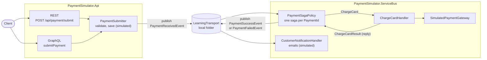
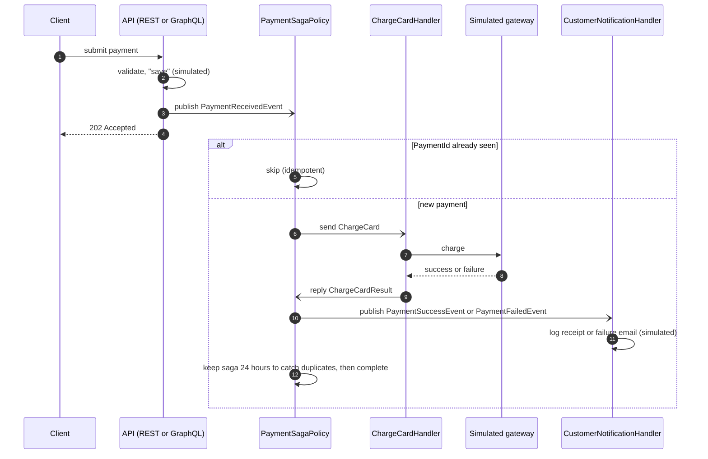

# Payment Simulator

[](https://github.com/mrk-jsph-dev/payment-simulator/actions/workflows/ci.yml)

A small proof of concept of an event-driven payment flow in .NET, built with **NServiceBus**
and the **saga** pattern. It is a personal project. The payment gateway and the database are
simulated, so no real payments or card data are involved.

It shows:

- one payment flow reachable from two entry points, **REST** (ASP.NET Web API) and **GraphQL** (Hot Chocolate)
- a **saga** that tracks each payment by `PaymentId` from received to succeeded or failed
- **idempotency**: a repeated request with the same `PaymentId` is skipped, not charged twice
- the gateway call kept out of the saga, in its own handler that replies with the result
- unit tests for the saga, the handler and the request rules, run in GitHub Actions

## Architecture

Two processes talk only through messages. The API accepts a request and publishes an event; the
NServiceBus endpoint does the rest.



| Project                       | What it does                                                         |
| ----------------------------- | -------------------------------------------------------------------- |
| `PaymentSimulator.Api`        | REST and GraphQL entry points. Validates and publishes the request.  |
| `PaymentSimulator.Events`     | The public events: received, succeeded, failed.                      |
| `PaymentSimulator.ServiceBus` | NServiceBus endpoint: the payment saga, gateway handler, notifications. |
| `PaymentSimulator.Tests`      | xUnit tests using `NServiceBus.Testing`.                             |

## Event flow

One payment, from request to notification:



## How to run

Requirements: the [.NET 10 SDK](https://dotnet.microsoft.com/download).

```bash
dotnet run --project PaymentSimulator.ServiceBus   # terminal 1: the message endpoint
dotnet run --project PaymentSimulator.Api          # terminal 2: REST + GraphQL on http://localhost:5075
dotnet test                                        # the tests
```

Then send a request with `PaymentSimulator.Api/PaymentSimulator.Api.http`, or open
`http://localhost:5075/graphql`, and watch the console of the ServiceBus endpoint.

Messages travel over NServiceBus's **LearningTransport**, which uses files in a local
`.learningtransport` folder. It needs no broker, and it is for local development only.

## Sample requests

### REST

`POST /api/payment/submit` returns `202 Accepted` with `{ "paymentId": "...", "status": "Accepted" }`.
The result of the payment arrives later as an event.

```json
{
  "paymentId": "3fa85f64-5717-4562-b3fc-2c963f66afe8",
  "amount": 199.99,
  "currency": "PHP",
  "paymentMethod": { "type": "CreditCard", "cardLast4": "4242", "cardBrand": "Visa" },
  "customer": { "customerId": "CUST-12345", "email": "jane.doe@example.com" },
  "reference": "ORDER-67890"
}
```

### GraphQL

```graphql
mutation SubmitPayment {
  submitPayment(
    paymentRequest: {
      paymentId: "3fa85f64-5717-4562-b3fc-2c963f66afb8"
      amount: 199.99
      currency: "PHP"
      paymentMethod: { type: "CreditCard", cardLast4: "4242", cardBrand: "Visa" }
      customer: { customerId: "CUST-12345", email: "jane.doe@example.com" }
      reference: "ORDER-67890"
    }
  ) {
    paymentId
    status
  }
}
```

Invalid requests (empty `paymentId`, amount of zero or less, a currency that isn't three
letters, `cardLast4` that isn't four digits) get a `400` validation problem on REST and a
`VALIDATION_ERROR` on GraphQL.

### Test cards

The simulated gateway decides the outcome from the card's last four digits, so every case can
be reproduced:

| `cardLast4` | Result             |
| ----------- | ------------------ |
| `0002`      | Card declined      |
| `9995`      | Insufficient funds |
| anything else | Success          |

## Sample console output

```text
[3fa85f64-...] Payment received, charging card
[3fa85f64-...] Gateway (simulated) SUCCESS for 199.99 PHP (Visa ****4242)
[3fa85f64-...] Payment succeeded
[3fa85f64-...] Sending receipt for 199.99 PHP (simulated)
```

Sending the same request again:

```text
[3fa85f64-...] Duplicate request skipped (idempotent), payment is already Succeeded
```

## What's simulated

This is a personal proof of concept. No real money, cards or customer data are involved.

| Part                          | In this repo                                                                  | Not here                       |
| ----------------------------- | ----------------------------------------------------------------------------- | ------------------------------ |
| Payment gateway               | `SimulatedPaymentGateway` waits one second and answers from the test card table above. | Any real payment provider |
| Database                      | The API only logs "saved". Nothing is stored apart from saga state.           | A real database                |
| Customer emails               | Log lines.                                                                    | Sending email                  |
| Message transport             | NServiceBus LearningTransport: files in a local `.learningtransport` folder.  | A message broker               |
| Saga persistence              | NServiceBus LearningPersistence, also local files.                            | A production saga store        |
| Card details                  | Only a brand and the last four digits, used to pick the test result.          | Card numbers, CVV or tokens    |

What is real: the NServiceBus message handling, the saga and its state changes, the duplicate
check by `PaymentId`, the 24-hour timeout, request validation, and the tests.

## What I'd add next

Future work. None of this is built yet.

- **Outbox.** Today the API "saves" and publishes as two separate steps, so a crash between them
  could lose or duplicate a message. NServiceBus's outbox, with a real database, would make the
  save and the publish one unit.
- **A real broker.** Swap LearningTransport for RabbitMQ or Azure Service Bus, and add
  end-to-end tests against it with Testcontainers.
- **A status query.** A REST and GraphQL query to read a payment's current status.

## Tech

.NET 10 · ASP.NET Web API · GraphQL (Hot Chocolate) · NServiceBus (sagas, timeouts,
LearningTransport) · xUnit · GitHub Actions
